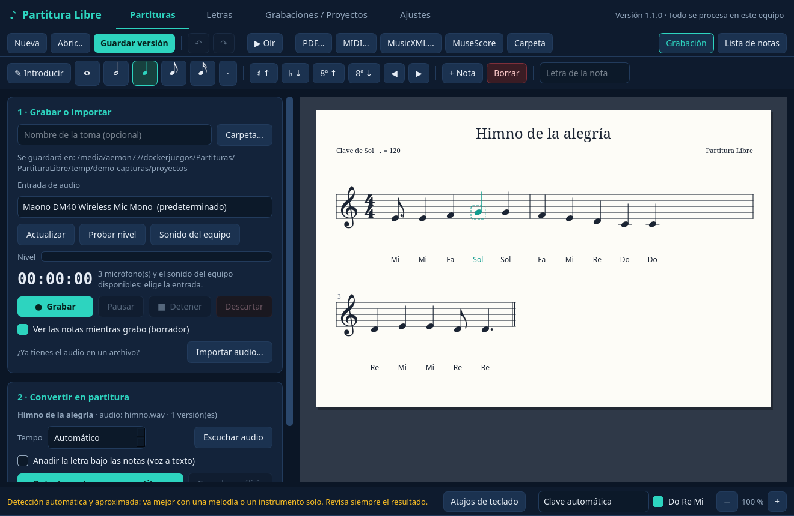
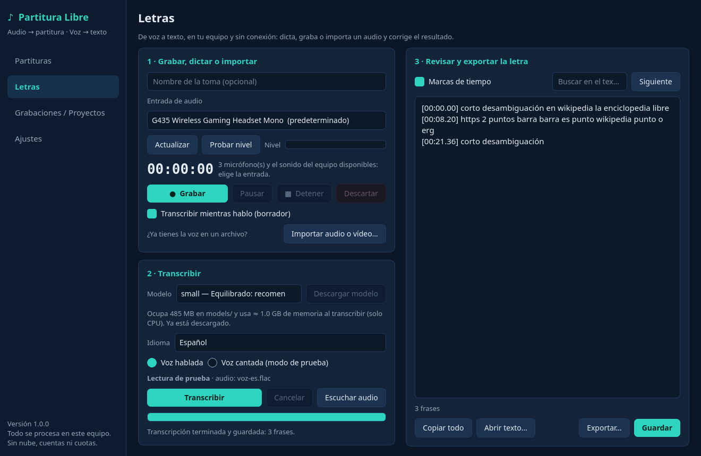

# Partitura Libre

Aplicación de escritorio gratuita para **Windows 11** y **Debian 13** (preparada para Ubuntu 24.04) con dos funciones:

- **Partituras:** graba o importa una melodía, detecta las notas y crea MIDI y MusicXML editables.
- **Letras:** pasa voz (hablada o cantada) a texto editable, con marcas de tiempo.

Todo se procesa en tu equipo: sin cuentas, sin nube, sin cuotas de minutos ni de exportaciones.

Creado por **aemon1977** · [github.com/aemon1977/PartituraLibre](https://github.com/aemon1977/PartituraLibre) · software libre (MIT). Las versiones para descargar están en [Releases](https://github.com/aemon1977/PartituraLibre/releases/latest).




## Descargar

| Sistema | Descarga (siempre la última versión) |
|---|---|
| **Windows 10/11** (64 bits) | [PartituraLibre-windows11-x64.zip](https://github.com/aemon1977/PartituraLibre/releases/latest/download/PartituraLibre-windows11-x64.zip) |
| **Linux** (Debian 12/13, Ubuntu 22.04/24.04 y posteriores, 64 bits) | [PartituraLibre-linux-x64.tar.gz](https://github.com/aemon1977/PartituraLibre/releases/latest/download/PartituraLibre-linux-x64.tar.gz) |

**No hay que instalar nada.** (En Linux basta con tener un escritorio gráfico, como el de cualquier Debian, Ubuntu, Mint o Fedora.) El paquete lo lleva todo dentro: el programa, Python, todas las bibliotecas (también las de audio), el modelo de voz `small` y el separador de voz. Descomprímelo en una carpeta tuya y ábrelo:

- **Windows:** doble clic en **`PartituraLibre.exe`**. Si Windows avisa de que viene de Internet, elige «Más información → Ejecutar de todas formas» (el programa no está firmado).
- **Linux:** `./iniciar-linux.sh` desde una terminal en esa carpeta.

Funciona sin conexión desde el primer momento. Ocupa unos 2 GB descomprimido. El programa se actualiza solo cuando se publica una versión nueva (se descarga solo lo que cambia, unos pocos MB). Todas las versiones: [Releases](https://github.com/aemon1977/PartituraLibre/releases).

## Es portable: una carpeta y nada más

Todo lo que el programa instala o descarga queda **dentro de su carpeta** (`runtime/`, `models/`, `data/`, `config/`, `logs/`, `temp/`). No pide contraseña de administrador y no toca el sistema, el registro ni tu perfil. **Para desinstalarlo, borra la carpeta** (o usa *Ajustes → Desinstalar*).

Lo único que no se borra con ella son las copias que tú exportes a otros sitios; el programa te avisa cada vez.

## Instalación

No hay instalación: ver [Descargar](#descargar). Solo se descarga algo más si tú lo pides desde la app (los modelos de voz más grandes, como `large-v3`, recomendado para canciones; o MuseScore, opcional), y siempre dentro de la carpeta del programa:

| Descarga opcional | Tamaño | Dónde |
|---|---|---|
| Modelo de voz `tiny` / `base` / `medium` / `large-v3` | 75 / 145 / 1530 / 3090 MB | `models/whisper/` |
| MuseScore Studio 4.7.5 portable (opcional; la app edita y exporta PDF sin él) | 195 MB (≈ 570 MB descomprimido) | `runtime/musescore/` |

### Desde el código fuente (para desarrollo)

Clonando el repositorio, `./iniciar-linux.sh` o `iniciar-windows.bat` descargan Python y los paquetes dentro de la carpeta en el primer arranque (≈ 1,4 GB). En Linux, desde el código, el audio usa la biblioteca `libportaudio2` del sistema; los paquetes de descarga llevan la suya.

## Uso

### Partituras

La sección está organizada como un editor de partituras:

- **Arriba, dos barras.** La de archivo: *Nueva*, *Abrir…*, *Guardar versión*, deshacer y rehacer, *▶ Oír*, *Letra*, *PDF…*, *MIDI…*, *MusicXML…*, *Carpeta* y los botones que muestran u ocultan los paneles laterales. La de notas: *✎ Introducir*, las cinco figuras (redonda a semicorchea) y el puntillo, semitono y octava arriba o abajo, mover la nota antes o después, *+ Nota*, *Borrar* y la letra de la nota elegida. y la casilla *Nombre de cada nota*. Abajo, en la barra de estado: *Atajos de teclado*, la clave y el zoom.
- **En el centro, la partitura** en una hoja: título, clave, compás de 4/4, barras y números de compás, figuras, silencios, nombres de nota y letra, repartida en sistemas según el ancho de la ventana.
- **A la izquierda, el panel *Grabación*** (grabar o importar, y convertir en partitura). **A la derecha, la *Lista de notas*** con los valores exactos.

**Todo se hace dentro de la app; no hace falta MuseScore** para editar, oír ni sacar el PDF.

Tres maneras de empezar:

- **Desde un audio.** Elige la entrada de audio, *Probar nivel* y *Grabar* (con *Ver las notas mientras grabo* la partitura se dibuja en vivo como borrador), o importa un WAV, MP3, FLAC u OGG. Después, *Detectar notas y crear partitura*. Con *Canción: melodía de la voz cantada con su letra* (activado por defecto), en un solo paso se aísla la voz de los instrumentos, se escribe **la melodía que se canta** (una sola línea, en el registro de la voz) y se coloca **una palabra de la letra bajo cada nota**. La letra se reconoce con el modelo más preciso que tengas (`large-v3` si está). Hace falta un modelo de voz y el separador (64 MB; la app lo ofrece la primera vez). Si en el audio no se oye letra cantada, las notas salen de todo el audio, como en una pieza instrumental. La voz aislada queda guardada en el proyecto (`voz aislada.wav`). **La partitura manda sobre la letra:** las notas detectadas no se dividen, ni se crean, ni se quitan por la letra; la letra se reparte sobre ellas, una sílaba por nota cuando hay notas suficientes y, si no, varias sílabas o palabras juntas en una nota. Para dejarla exacta, pulsa **Escribir letra…**: escribe o pega la letra completa y se reparte sola en sílabas, una por nota, desde la primera o desde la nota elegida (una palabra escrita con guiones, «be-be-ré», se divide por ahí). Debajo de «Canción» eliges con qué modelo se reconoce la letra. A una partitura ya creada se le pone la letra con el botón *Letra*, sin volver a detectar las notas.
- **Desde una partitura existente.** *Abrir…* convierte un MusicXML, MXL o MIDI en una partitura editable; el archivo original se guarda en el proyecto.
- **En blanco.** *Nueva* crea una hoja vacía con el modo *Introducir* activado.

Editar, con las mismas teclas que MuseScore:

| Tecla | Qué hace |
|---|---|
| **N** | Entra o sale del modo de introducción de notas |
| **3 4 5 6 7** | Semicorchea, corchea, negra, blanca, redonda. En modo introducir eligen la figura de la próxima nota; fuera de él cambian la nota elegida |
| **.** (punto) | Puntillo |
| **A B C D E F G** | La Si Do Re Mi Fa Sol. En modo introducir escriben la nota tras la elegida, en la octava más cercana a la anterior; fuera de él cambian la altura de la nota elegida |
| **Mayús + letra** | Añade esa nota al acorde |
| **0** | Silencio de la figura elegida |
| **↑ ↓** | Sube o baja un semitono; con **Ctrl**, una octava |
| **← →** | Nota anterior o siguiente; con **Mayús**, mueve la nota en el tiempo una semicorchea |
| **Ctrl+L** | Escribir la letra: espacio o guion pasan a la nota siguiente, Esc vuelve a la partitura |
| **Supr** | Borra la nota (queda un silencio) |
| **Ctrl+Z / Ctrl+Y** | Deshacer y rehacer |
| **Espacio** | Oír desde la nota elegida |
| **Esc** | Sale del modo introducir o quita la selección |

La casilla *Nombre de cada nota* escribe bajo cada una lo que es (Do, Re, Mi, Fa♯…) en azul, para no confundirlo con la letra, que va en negro; y al pasar el ratón por encima de una nota aparece su ficha completa: nombre con octava, figura, cuándo empieza, cuánto dura y su letra.

Con el ratón: clic elige una nota, arrastrarla arriba o abajo cambia su altura y, en modo introducir, un clic en el pentagrama escribe una nota a esa altura. Al introducir una nota en medio, las siguientes se desplazan para hacerle sitio. Todo está también en los botones de la barra de notas, y los valores exactos en el panel *Lista de notas*.

**Tonalidad y ritmo.** La tonalidad se detecta sola y se escribe su armadura; las notas se nombran según ella (Si♭ en Fa mayor, no La♯) y las alteraciones valen hasta el final del compás, con becuadro cuando hace falta. Puedes fijarla a mano en la barra inferior. Una nota que cruza la barra de compás se escribe ligada. Si el tempo detectado no encaja, pulsa *Marcar pulso* al ritmo de la canción (4 veces o más) y se fija solo.

**Reproductor.** Arriba: ⏪ y ⏩ (5 s atrás y adelante), ▶/⏸ (también Espacio), ⏹, una barra en la que un clic lleva justo a ese punto, y el tiempo. Por defecto suena la **canción original**; también puedes oír la **voz aislada** o la partitura tal como está escrita. Mientras suena, una **línea naranja avanza sobre la partitura** y se resaltan la nota y **la sílaba** que se están cantando. Si eliges una nota, empieza desde ahí.

**Parar.** «Parar (conserva lo hecho)» termina el análisis y crea la partitura con lo que lleve: si estaba reconociendo la letra, hasta donde llegó; si estaba sacando las notas, hasta el trozo en curso. Pulsándolo otra vez se cancela del todo.

**Tempo.** Al convertir con el tempo en «Automático», además del tempo de la canción se detectan sus **cambios de tempo** (solo los claros y que se mantienen) y se escriben en el compás donde empiezan, con su indicación: «Andante ♩ = 99», «Allegro ♩ = 130»… La marca de tempo va sobre el primer compás y sobre cada cambio; **pulsándola** la renombras ahí mismo: «Con brío», «Allegro 120» (también cambia la velocidad) o «♩ = 120»; Intro para guardar, Esc para dejarla. Con el botón **Tempo…** (abajo) cambias el tempo y la indicación desde el compás de la nota elegida, o el del principio si no hay ninguna elegida, o quitas un cambio. Al guardar la versión van al MusicXML.

**Acordes.** Al convertir una canción se reconocen sus acordes (mayores y menores, con preferencia por los de la tonalidad) y se escriben encima del pentagrama, como en un cancionero: Do, Lam, Fa♯m… Se guardan con la partitura, no se pierden al editar y van al MusicXML (MuseScore los muestra como cifrado). Las partituras hechas antes de la versión 1.9 no los tienen: vuelve a convertir la canción.

Los análisis largos muestran cuánto tiempo queda.

**Equipos modestos** (4 hilos o menos, o menos de 12 GB de memoria, como un mini PC con Ryzen 3): la letra de las canciones se reconoce con `small` y un solo candidato, y los análisis van con prioridad baja dejando un núcleo libre para que la ventana no se trabe. Medido con 4 hilos: un minuto de canción tarda ≈ 1 min 45 s en total (separar la voz, reconocer la letra y sacar las notas) y usa ≈ 1,8 GB de memoria.

Guardar y exportar: *Guardar versión* crea MIDI y MusicXML nuevos con tus cambios, sin pisar los anteriores. *PDF…* escribe en A4 la partitura tal como la ves, con clave, nombres y letra. MuseScore es opcional: si lo tienes, aparece un botón para abrir en él el MusicXML guardado.

> La hoja de la app coloca cada nota a su altura exacta, elige la figura más parecida a su duración y marca compases y silencios según el tempo. No dibuja ligaduras, tresillos ni armaduras; el puntillo solo aparece en duraciones exactas (las que escribes tú), y las alteraciones se escriben siempre con sostenidos. El MusicXML se cuantiza a semicorcheas.
>
> La detección desde audio es automática y aproximada. Va bien con una melodía o un instrumento solo. Con varios instrumentos, acordes densos o batería habrá notas falsas o ausentes: revisa siempre el resultado.

### Letras

1. **Elige un modelo** y pulsa *Descargar modelo* (una sola vez). `small` es el recomendado para español; `tiny` y `base` son más rápidos y fallan más; `medium` y `large-v3` son más precisos y lentos.
2. **Elige la entrada de audio.** El botón *Sonido del equipo* selecciona con un clic la captura directa de lo que suena en el ordenador. Además de los micrófonos, aparece al final de la lista la entrada **«Sonido del equipo (lo que suena en este ordenador)»**, que graba directamente lo que reproduce otra aplicación (Spotify, un vídeo, una videollamada); en Linux localiza sola la salida por la que está sonando, sean altavoces o auriculares; en Windows captura la salida predeterminada. Para transcribir algo que suena en el ordenador usa siempre esa opción y no el micrófono: por los altavoces llega flojo y con ruido, y el reconocimiento sale vacío.
3. **Graba, dicta o importa** audio o vídeo (WAV, MP3, FLAC, OGG, M4A, MP4, MKV…). Con *Transcribir mientras hablo* aparece un borrador cada pocos segundos; al detener, la toma completa se transcribe de nuevo con más precisión.
4. **Idioma:** español, detección automática u otro de la lista.
5. **Voz hablada o voz cantada (modo de prueba).** Para canciones con instrumentos hay dos ayudas, y se suman: **separar la voz de la música** antes de transcribir (pulsa *Descargar separador*, 64 MB, una sola vez; tarda en torno a un tercio de la duración del audio) y usar el modelo **large-v3** (3 GB), que con canto acierta claramente más que `small`. Los versos poco fiables se marcan con **⚠** para que los escuches y corrijas; el programa no inventa texto donde no entiende. Aun así, la letra de una canción rara vez sale perfecta: revísala.
6. **Revisa y exporta.** El texto es editable (una línea por frase, marcas `[mm:ss.cc]` opcionales), se puede buscar y copiar, y se exporta a **TXT, SRT, VTT o LRC**.

### Grabaciones / Proyectos

Historial de todas las tomas con su audio y sus resultados. Desde aquí puedes reabrirlas, ver su carpeta, exportar una copia o eliminarlas.

### Ajustes

Modelos de voz, MuseScore portable, **Diagnóstico** (runtime, micrófonos, motores, modelos, editor, espacio libre; guarda un informe en `logs/` sin grabaciones ni datos personales), tamaño de cada carpeta, vaciado de temporales y **desinstalación**.

## Actualizaciones

Cada instalación se actualiza sola con la versión **de su propio sistema**: una de Windows baja el paquete de Windows (con su `PartituraLibre.exe`) y una de Linux, el de Linux (con su `iniciar-linux.sh`).

1. Al abrirse, el programa pregunta a GitHub cuál es la última versión. Solo pide el número de versión: no envía ningún dato tuyo.
2. Si hay una más nueva, la descarga en segundo plano y comprueba que llega íntegra y que es la versión anunciada.
3. La próxima vez que abras el programa (o al pulsar «Reiniciar ahora») se sustituye: el programa y su lanzador. Si la versión nueva necesita otras bibliotecas, se ponen al día solas dentro de la carpeta.

Tus grabaciones, partituras, modelos y ajustes no se tocan, y la versión anterior se guarda en `app.anterior/`. Para volver a ella: `./iniciar-linux.sh --deshacer-actualizacion` o `PartituraLibre.exe --deshacer-actualizacion`.

En *Ajustes → Acerca de* puedes buscar a mano, desactivar la consulta al abrir o pedir que pregunte antes de descargar. Cada versión publicada se prueba en GitHub actualizando una instalación antigua en Windows y en Linux.

## Formatos de salida

| Sección | Archivos |
|---|---|
| Partituras | `.wav` (toma original), `.mid`, `.musicxml`, `.notas.json` (notas editables), `.pdf` |
| Letras | `.wav` u original importado, `.txt`, `.letra.json` (frases con tiempos), `.srt`, `.vtt`, `.lrc` |

Cada proyecto es una carpeta en `data/proyectos/` (o donde tú elijas).

## Solución de problemas

| Síntoma | Qué hacer |
|---|---|
| El lanzador dice que un conjunto de paquetes no funciona | `./iniciar-linux.sh --reparar` o `PartituraLibre.exe --reparar`. Reinstala dentro de la carpeta, nada global. |
| Quiero ver qué falla sin abrir la ventana | `./iniciar-linux.sh --diagnostico` (o `PartituraLibre.exe --diagnostico` desde una terminal). |
| «No se pudo cargar PortAudio» (Linux) | Con el paquete de descarga no debería pasar (lleva su PortAudio). Desde el código fuente, falta `libportaudio2` del sistema. |

| «No se pudo abrir el micrófono» | Otro programa lo está usando o no hay permiso. Pulsa *Actualizar* y elige otro. En Windows: Configuración → Privacidad y seguridad → Micrófono. |
| No aparece mi micrófono | Conéctalo y pulsa *Actualizar*. En Linux se listan los que publica PipeWire/PulseAudio; si no hay servidor de sonido se muestran los dispositivos ALSA. |
| La transcripción sale vacía | El motor no encontró voz inteligible y no inventa texto. Si era música del propio equipo, grábala con «Sonido del equipo»; si es una canción, marca «Voz cantada»; revisa el idioma y prueba el modelo `medium`. |
| «Nivel de grabación muy bajo» | Acerca el micrófono o sube la entrada en el control de sonido del sistema. |
| «La toma está en silencio» | El micrófono está silenciado, apagado o no es la entrada elegida. Usa *Probar nivel*. |
| «Grabación incompleta» | El equipo iba muy cargado o el disco se llenó. La toma se conserva; el aviso dice cuánto falta. |
| La transcripción se cierra sola | Falta memoria: usa un modelo más pequeño. Detalle en `logs/motores.log`. |
| No suena *▶ Oír* | Usa la salida de audio predeterminada del sistema: compruébala en el control de sonido. |
| MuseScore no arranca (Linux) | Es opcional. La copia portable necesita X11 o XWayland (lo normal en escritorios actuales). |
| El programa se cerró mientras grababa | Al volver a abrirlo, la toma aparece como «Interrumpida» con el audio hasta el corte. |

## Versión anterior

La interfaz clásica (1.0, con tarjetas en dos columnas) se conserva en la etiqueta `v1.0-clasica` del repositorio y, en el equipo de desarrollo, como copia ejecutable en la carpeta hermana `PartituraLibre-v1-clasica`.

## Para desarrollo

```sh
./herramientas/probar.sh            # todas las pruebas, con el runtime portable
./herramientas/bloquear.sh          # regenera app/requisitos/*.txt (bloqueos con hashes)
./herramientas/publicar.sh "novedades"  # publica en GitHub la versión actual; las instalaciones se actualizarán
python3 herramientas/empaquetar.py  # crea dist/ con los tres paquetes
```

Arquitectura y decisiones: [docs/ARQUITECTURA.md](docs/ARQUITECTURA.md) · Licencias: [docs/LICENCIAS.md](docs/LICENCIAS.md) · Qué se ha probado de verdad: [docs/INFORME-PRUEBAS.md](docs/INFORME-PRUEBAS.md)
